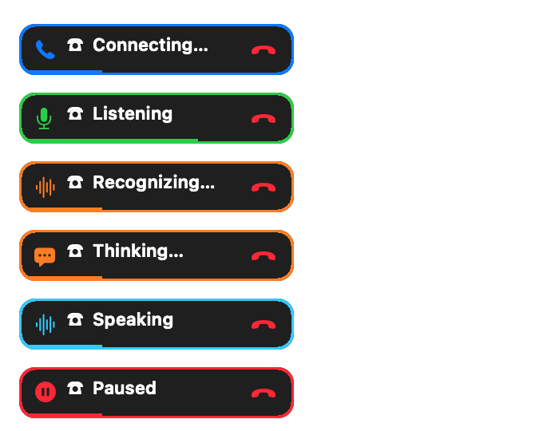

# 双击鲸鱼娘，直接与 Harness 会话通话

工作版本：**桌宠 0.6.0/build 19，语音插件 0.5.0**。

## 使用

1. 在后台运行 DeepSeek Harness，安装并启用新版 `dsh-whale-voice`。配置聊天模型，并在 Voice Input 中准备好当前选择的识别模型。
2. 打开新版 `desktop-preview/Whale Companion.app`，加载豆包语音配置并开启 Sound。首次通话时允许 macOS 麦克风访问。
3. 双击角色开始通话。已有绑定则使用该会话；未绑定时，插件创建并复用普通的 **Whale Voice Conversation**。不需要打开 DeepSeek 网页或 DS Bot/Harness 聊天页面，Harness 后台必须保持运行。
4. 看到绿色 Listening 后说话。约 1.1 秒停顿后进入识别和思考，回复由鲸鱼娘朗读；声音播完后恢复聆听。每句录音最多 20 秒，收音和播放采用轮流进行的方式。
5. 再次双击或点击状态条的红色电话挂断。桌宠菜单也有 **Start / End Voice Call**、**Pause Voice Call**、**Resume Voice Call**。

新建普通会话使用 Harness 默认聊天模型；已有绑定会话保留原有模型、身份与上下文。绑定会话忙碌或不可用时不暗中换会话。识别器未准备、聊天模型未配置或豆包/Sound 不可用时需先完成对应配置，不会自动下载模型或切换到其他识别后端。

## 电话状态与形象



| 状态 | 标识 | 含义 |
| --- | --- | --- |
| Connecting | 蓝色电话 | 正在连接 Harness 会话和桌宠播放通道 |
| Microphone… | 橙色麦克风 | 正在请求权限或启动输入设备 |
| Listening | 绿色麦克风、音量条 | 麦克风已开启，角色有轻微聆听姿态 |
| Recognizing… | 橙色波形 | 收音已停止，Harness 正在识别这一句 |
| Thinking… | 橙色气泡 | 会话已收到识别文字，Agent 生成或执行工具；角色有缓慢思考姿态 |
| Speaking | 青色波形、音量条 | 以实际音频起播为依据，现有音量动作继续生效 |
| Paused / Unavailable | 红色暂停/电话 | 暂停或不可用，悬停可查看具体提示 |

状态条是角色的独立附属窗口：随角色移动，避免缩小形象时文字一起变小；靠近屏幕顶部时移到角色下方。图标和文字同时区分状态，红色电话提供直接挂断入口。

双击不触发第一次单击的戳一戳动作。非通话时，单击会等待系统双击时间再触发互动；通话中单击不额外播放戳一戳录音。原有拖动、缩放和长按摸头仍保留。

## 会话与感知链路

```text
双击角色
  → 同用户 socket 发起通话
  → 选择绑定会话，或通过公开接口创建/复用普通 Harness 会话
  → 取得桌宠播放通道
  → 麦克风采集、停顿分句
  → speechController.transcribe
  → Session controller.prompt 投递识别文字
  → 正常 Agent loop、公开回复流
  → 豆包流式合成和真实播放
  → 最终输入结束且音频播完
  → 短暂输出排空延迟后恢复聆听
```

Agent 的身体上下文同步通话阶段与已确认的麦克风聆听状态，识别后的输入标记为 ASR。思考状态覆盖模型生成和工具步骤，不把模型结束或一句话的停顿当成整轮语音完成。识别没有文字时恢复聆听，不向 Agent 发送空消息。

## 生命周期与数据

录音使用规范的 16 kHz、单声道 PCM16 WAV。每个 socket 音频块最多 32 KB，总录音不超过 20 秒；宿主再次限制大小、序号和编码，识别服务通过公开接口验证 WAV。音频只保存在内存，不写原始录音文件或日志。识别文字作为普通用户消息保留在正常会话中，语音凭证留在桌宠中。

暂停、挂断、隐藏、静音、休眠、设备/会话不活跃会停止麦克风；音频设备变更或转换失败会暂停。过期权限回调、ASR 结果和旧通话状态均不能重新开麦或投递文字。挂断不取消 Agent 已接受的任务。后端失联约 8 秒本地停止；宿主沿用原有 15 秒通话租约。桌面和浏览器共享单通话限制，不同时占用声音。

## 实现入口

- `desktop-preview/VoiceCapture.swift`：权限、麦克风、采样转换、停顿分句和 WAV。
- `desktop-preview/NativeCall.swift`：桌面通话状态、分块提交、暂停/恢复和心跳。
- `desktop-preview/CallStatus.swift`：电话标识、挂断按钮、双击仲裁和预览导出。
- `desktop-preview/NativeCallMenu.swift`：角色入口、附属状态窗和休眠处理。
- `harness-voice/native-call.js`：公开识别服务、会话投递、音频限额和迟到结果隔离。
- `harness-voice/host.js`：普通语音会话的创建和复用。

所有 Harness 接入都通过公开插件服务，没有修改 Harness 源码、安装文件或读取私有会话/凭证。本仓库发布上述源码；安装、重载和重启由用户在无通话时执行，不会自动改变运行中的 Harness 或桌宠。

## 验证

- 语音插件：36 项单元测试通过，包含无浏览器通话、暂停/挂断后的迟到识别、空识别、竞争通话、启动取消、乱序/超限/超时录音。
- 宿主集成：通过真实公开存储与 systemPrompt 组装接口，模拟 Session/ASR/桌宠，验证会话创建复用、识别文字投递、动作与通话状态隔离。
- 原生桌宠：编译和内置自检通过，覆盖麦克风与状态顺序、多轮音频完成后恢复聆听、断连、迟到权限和单/双击仲裁；使用模拟麦克风与音频输出。
- 状态条通过原生绘制导出并检查。导出预览不会启动桌宠实例、申请麦克风或连接 Harness。
- 客户端生成一致性检查通过；DS Bot 的 318 项测试在本轮复验通过。
- 整套 DS Bot 模拟冒烟仍未通过：Chief 未产生预期提问卡，后续 Writer 步骤无法继续。它未加载鲸鱼娘插件，不能作为本功能的端到端通过证据。

未申请或使用真实麦克风，没有调用真实模型或付费 TTS；因此收音质量、噪声环境下分句、声学回声和整链延迟尚待实际联调。
